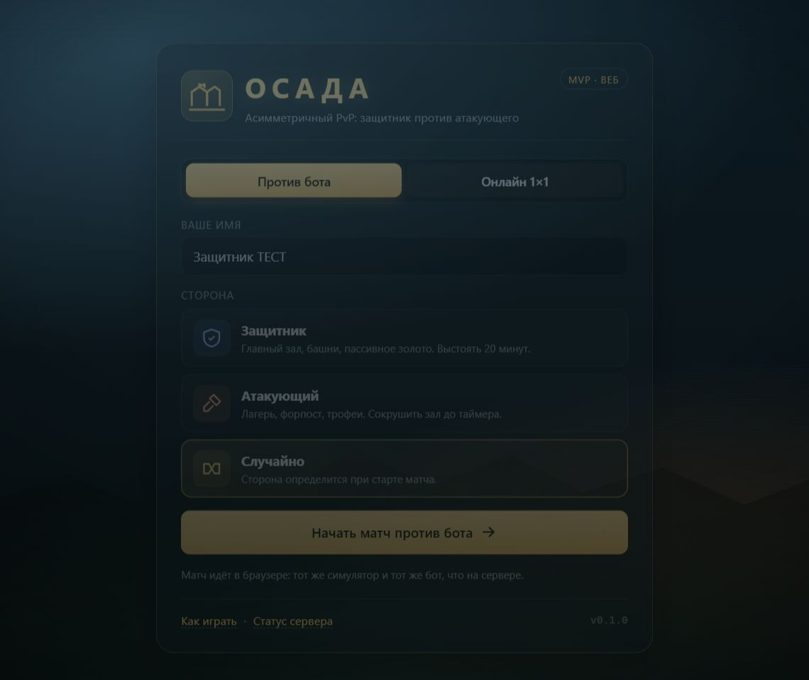
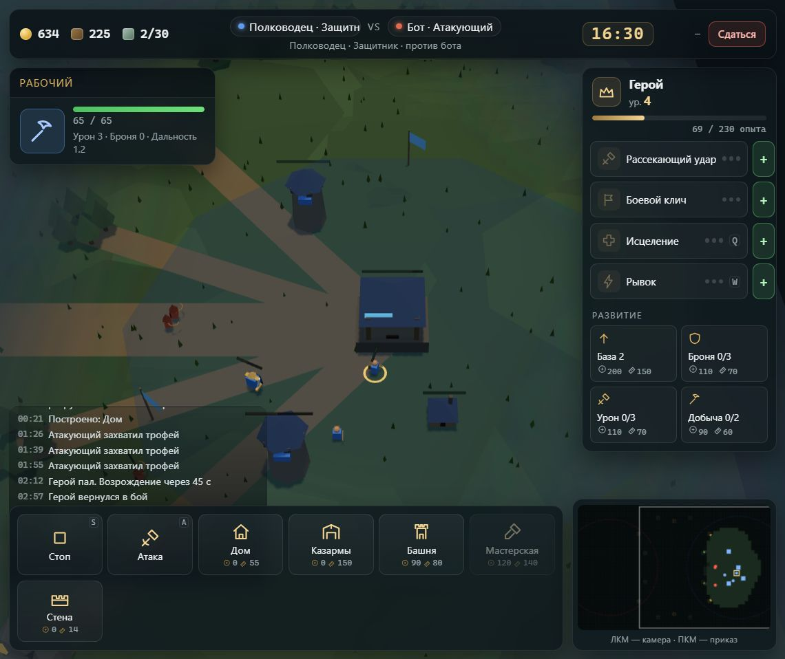
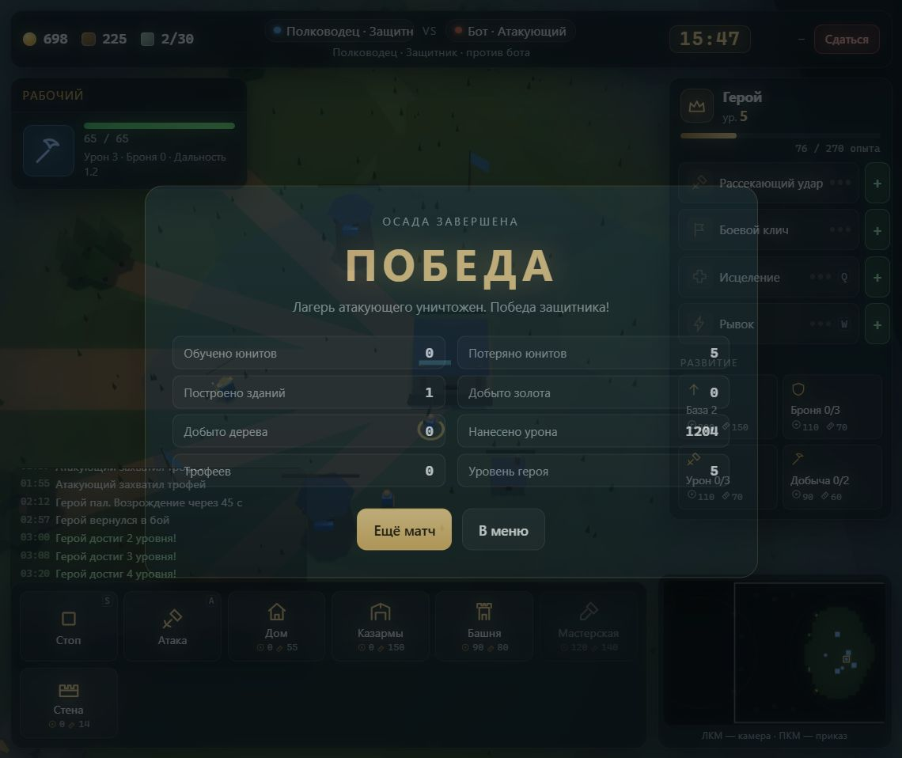

# Осада — асимметричный PvP-режим

Играбельная веб-версия PvP-режима «Осада»: защитник против атакующего.
Один матч — 20 минут, экономика на золоте и дереве, осадные войска, герой,
технологии, туман войны, бот и онлайн 1×1 по коду комнаты.

[](https://github.com/HBBoy102011/osada/actions/workflows/ci.yml)

**Демо:** https://osada.onrender.com



## Что внутри

| | Защитник | Атакующий |
|---|---|---|
| Цель | Продержаться 20 минут или снести лагерь врага | Разрушить главный зал до конца таймера |
| База | Главный зал, две башни, пассивное золото | Лагерь, форпост, трофеи в центре карты |
| Экономика | Рабочие → золото/дерево, пассивный доход | Рабочие → золото/дерево, золото за трофеи |
| Стартовые войска | 4 рабочих, 2 пехотинца, герой | 4 рабочих, 2 пехотинца, герой |

- **Экономика:** золото и дерево, лимит снабжения, дома, очередь обучения.
- **Строительство:** дом, казарма, мастерская, башня, стена, форпост.
- **Войска:** рабочий, пехотинец, лучник, катапульта, герой.
- **Герой:** опыт и уровни, навыки «Рассекающий удар», «Боевой клич»,
  «Исцеление», «Рывок», возрождение через 45 секунд.
- **Развитие:** 3 уровня базы, технологии урона, брони и добычи.
- **Туман войны:** сервер отдаёт каждой стороне только видимые объекты.
- **Онлайн 1×1:** комнаты с 4-символьным кодом, авторитетный сервер,
  переподключение по токену в течение 60 секунд, чат, сдача.
- **Оффлайн:** тот же симулятор и тот же бот, что на сервере, — без сети.
- **Баланс:** вынесен в `public/data/balance.json`, без хардкода в логике.



## Управление

| Действие | Клавиша |
|---|---|
| Выбор / добавить к выделению | ЛКМ / `Shift` + ЛКМ |
| Приказ: движение, атака, добыча, ремонт | ПКМ |
| Камера / зум | `W A S D`, стрелки / колесо |
| Атака по площади | `A` |
| Стоп | `S` |
| Герой | `F` |
| Способности героя | `Q`, `W` |
| Чат | `Enter` |
| Группы | `Ctrl` + `1…9`, выбор — `1…9` |

Недостроенное здание можно достроить: выделите рабочих и нажмите ПКМ по площадке.
Повреждённое здание ремонтируется тем же приказом.

## Технологии

- **Клиент:** TypeScript, Three.js, Vite; DOM-HUD поверх WebGL-сцены.
- **Сервер:** Node.js, `ws`, собственный HTTP-сервер статики.
- **Симуляция:** общий детерминированный модуль `src/shared` для сервера
  и оффлайн-режима; тик 20 Гц, снапшоты 8 Гц.
- **Тесты:** Vitest — симуляция, экономика, бой, туман войны, A*, бот,
  HTTP и WebSocket-сценарии.
- **Деплой:** Render Blueprint или Docker.

## Локальный запуск

Нужен Node.js 20+.

```bash
npm install
npm run dev          # клиент http://localhost:5173, сервер http://localhost:8080
```

Или production-сборка одним процессом:

```bash
npm run build
npm start            # http://localhost:8080
```

Проверки:

```bash
npm run typecheck    # tsc для клиента и сервера
npm test             # 43 теста
npm run build        # dist/public + dist/server
```

Отладочный хук: откройте игру с `?debug=1`, чтобы получить `window.__osada`
(активная игра, мир, сцена, выбранные юниты).

## Архитектура

```
Браузер
  Three.js + HUD ── команды ──┐
  оффлайн: World + Bot         │
                               ▼
                        WebSocket /ws
                               │
                    Node.js (authoritative)
                    RoomManager → Room
                      World.tick(20 Гц)
                      8 Гц снапшоты с туманом
```

- **Один источник правды.** `src/shared/world.ts` — симуляция: экономика,
  строительство, бой, герой, туман, победа. Сервер и оффлайн-клиент
  используют один и тот же код.
- **Сервер авторитетен.** Клиент присылает только команды; сервер проверяет
  владельца юнитов, стоимость, радиусы, лимиты и рассылает снапшоты.
- **Туман войны на сервере.** Снапшот собирается отдельно для каждой команды,
  поэтому скрытые войска физически не попадают в браузер противника.
- **Реконнект.** В `joined` приходит токен; после обрыва он позволяет вернуться
  в тот же слот в течение 60 секунд. Иначе засчитывается поражение.
- **Данные баланса.** `public/data/balance.json` — юниты, здания, технологии,
  герой, тайминги. Логика читает только эти значения.

Подробнее: [docs/ARCHITECTURE.md](docs/ARCHITECTURE.md).



## Тесты

```bash
npm test
```

- `tests/world.test.ts` — расстановка, экономика, строительство, обучение,
  технологии, герой, бой, победа, туман, валидация команд.
- `tests/pathfinding.test.ts` — A*, объезд стен, запрет срезания углов,
  путь между базами на сгенерированной карте.
- `tests/bot.test.ts` — длинный матч бот против бота: добыча, дома, казармы,
  армия, навыки героя, отсутствие NaN.
- `tests/server.test.ts` — HTTP, создание комнаты, роли, старт, чат, команды,
  сдача, переподключение по токену.

## Деплой

### Render

В репозитории есть `render.yaml` (Node runtime, health check `/api/health`).
Создайте Blueprint из репозитория или Web Service вручную:

- Build: `npm ci && npm run build`
- Start: `npm start`
- Health check: `/api/health`

Сервер читает `PORT` и `HOST` из окружения. Автодеплой в Blueprint выключен:
после пуша обновляйте сервис кнопкой **Deploy latest commit**.

### Docker

```bash
docker build -t osada .
docker run --rm -p 8080:8080 osada
```

## Структура

```
src/shared/    детерминированная симуляция, карта, A*, бот, протокол
src/server/    HTTP-статика, /api/health, /api/balance, WebSocket-комнаты
src/client/    Three.js-сцена, ввод, HUD, меню, онлайн/оффлайн-сессии
tests/         Vitest
public/data/   balance.json
docs/          архитектура и скриншоты
```

## Соответствие ТЗ

| Требование | Реализация |
|---|---|
| Асимметричный PvP защитник/атакующий | разные базы, цели, экономика и пассивный доход |
| Таймер 20 минут | `match.durationSeconds = 1200`, победа защитника по времени |
| Экономика: золото, дерево, снабжение | добыча, ноша, дома, лимит 100 |
| Строительство и производство | 6 типов зданий, очереди, лимиты |
| Бой | пехота, лучники, катапульты, башни, стены, герой |
| Герой и технологии | 4 навыка, опыт/уровни, 3 технологии по 3 уровня |
| Туман войны | серверная фильтрация снапшотов по команде |
| Переподключение 60 секунд | токен сессии, grace-таймер, forfeit по истечении |
| Сдача | команда `surrender` и подтверждение в интерфейсе |
| Бот | общий `Bot` поверх тех же команд, что у игрока |
| Онлайн 1×1 по коду | комнаты на 4 символа, автозапуск через 3 секунды |
| Data-driven баланс | `public/data/balance.json` |
| Оригинальные названия и арт | собственная карта, модели и UI, без чужих ассетов |

**Про Unity.** В ТЗ указан Unity LTS, но в среде выполнения не было ни
редактора, ни лицензии, ни возможности скачать многогигабайтный установщик.
Чтобы сдать играбельный результат, стек заменён на TypeScript + Three.js
с авторитетным Node-сервером. Все игровые системы из ТЗ сохранены; общий
модуль симуляции отделён от рендера и транспорта, поэтому логика переносима.

## Ограничения MVP

- Одна карта и одна фракция; нет мета-прогрессии и рейтинга.
- Один процесс без горизонтального масштабирования; комнаты живут в памяти.
- Нет голосового чата и друзей; только код комнаты и текстовый чат.
- Бот — конечный автомат, не обучаемый ИИ.

## Лицензия

MIT — см. [LICENSE](LICENSE).
